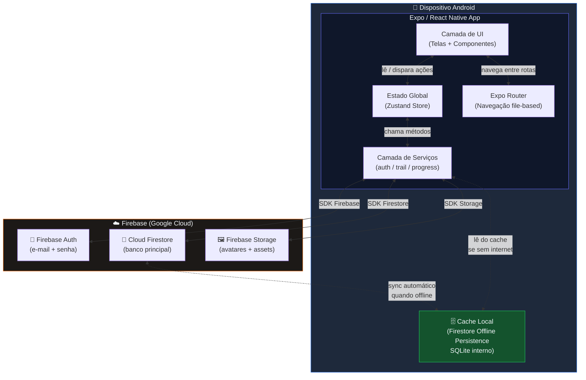
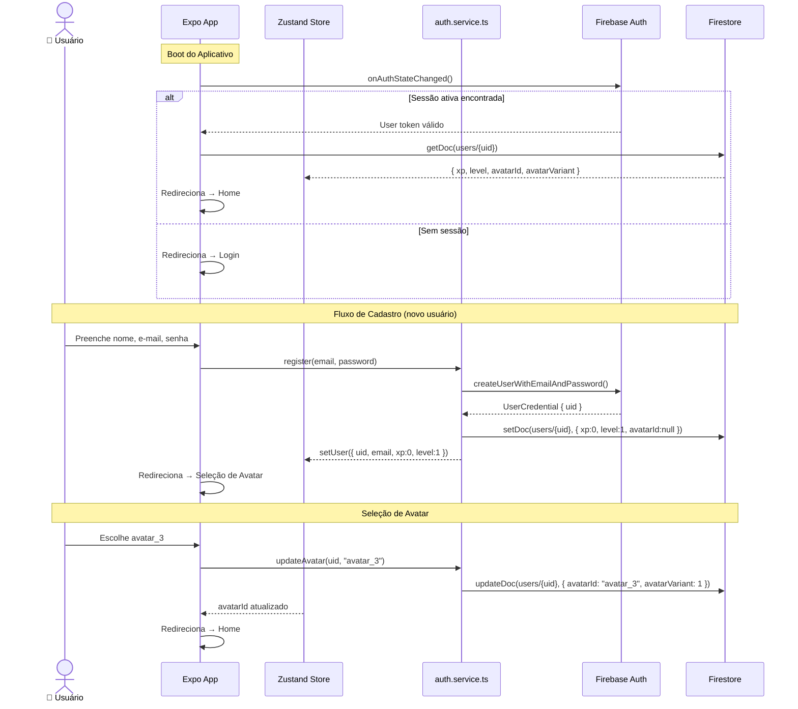
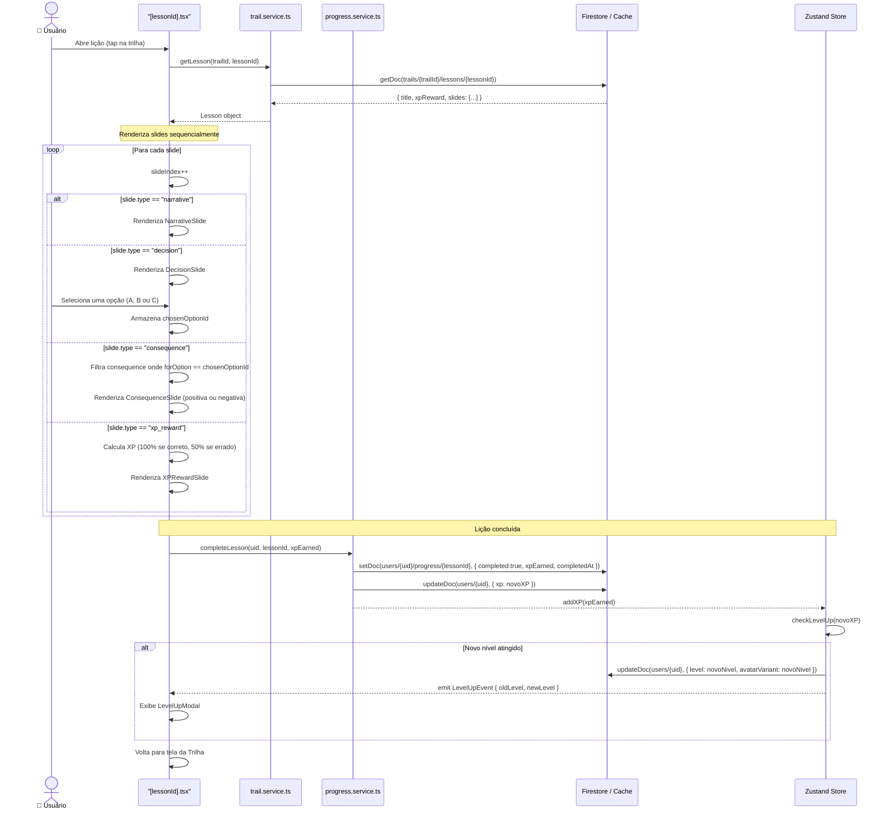
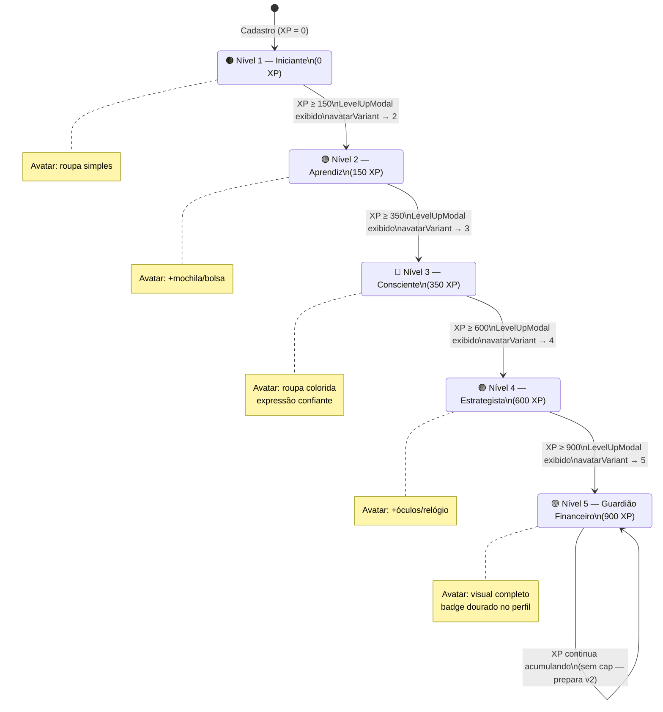
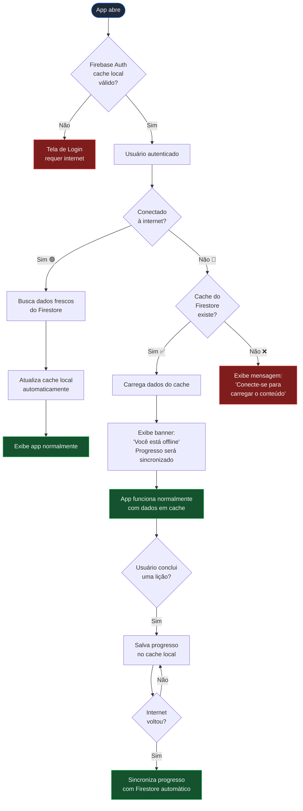
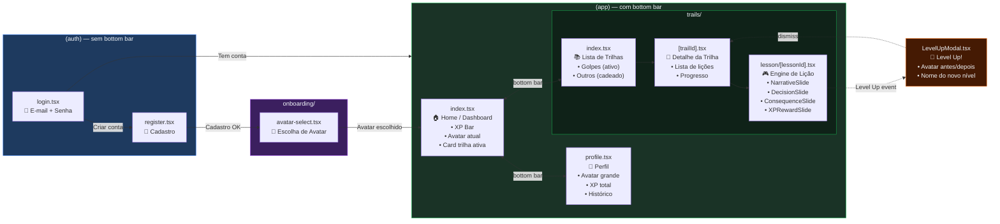
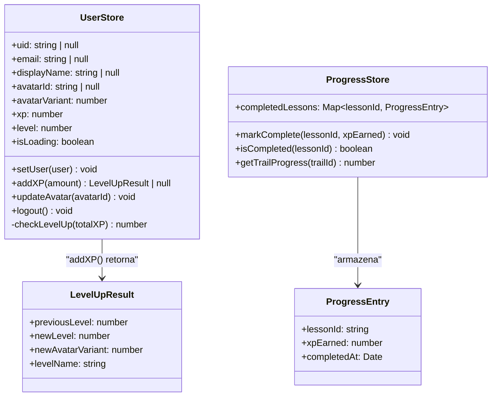

# Arquitetura Técnica — FinEdu App
### Fluxo de Dados: Expo ↔ Firestore ↔ Firebase Auth
**Versão:** 1.0 | **Referência:** PRD FinEdu v1.0

---

## 1. Visão Geral do Sistema



---

## 2. Fluxo de Autenticação



---

## 3. Engine de Lição — Fluxo de Dados



---

## 4. Sistema de XP e Progressão de Nível



---

## 5. Estratégia Offline — Árvore de Decisão



---

## 6. Mapa de Telas e Navegação (Expo Router)



---

## 7. Modelo de Estado Global (Zustand)



---

## 8. Camada de Serviços — Contratos de Interface

```typescript
// services/auth.service.ts
interface AuthService {
  register(name: string, email: string, password: string): Promise<string>; // retorna uid
  login(email: string, password: string): Promise<void>;
  logout(): Promise<void>;
  onAuthChange(callback: (user: User | null) => void): Unsubscribe;
}

// services/trail.service.ts
interface TrailService {
  getTrails(): Promise<Trail[]>;
  getLesson(trailId: string, lessonId: string): Promise<Lesson>;
  getLessonsForTrail(trailId: string): Promise<LessonSummary[]>;
}

// services/progress.service.ts
interface ProgressService {
  completeLesson(uid: string, lessonId: string, xpEarned: number): Promise<void>;
  getUserProgress(uid: string): Promise<Map<string, ProgressEntry>>;
  updateUserXPAndLevel(uid: string, newXP: number, newLevel: number, avatarVariant: number): Promise<void>;
}
```

---

> [!TIP]
> **Princípio de design:** Toda a lógica de negócio (cálculo de XP, verificação de level up, desbloqueio de lição) vive na **Zustand Store** e nos **Services** — as telas (`app/`) são puramente declarativas e não contêm lógica. Isso facilita testes unitários e manutenção futura.

> [!NOTE]
> **Sobre o Engine de Lição:** O componente `[lessonId].tsx` nunca "conhece" o conteúdo — ele apenas itera sobre o array `slides` retornado pelo Firestore e delega a renderização para o subcomponente correto baseado no campo `type`. Adicionar um novo tipo de slide (ex: `video`, `flashcard`) no futuro requer apenas um novo componente + suporte no switch, sem alterar a estrutura do banco.
